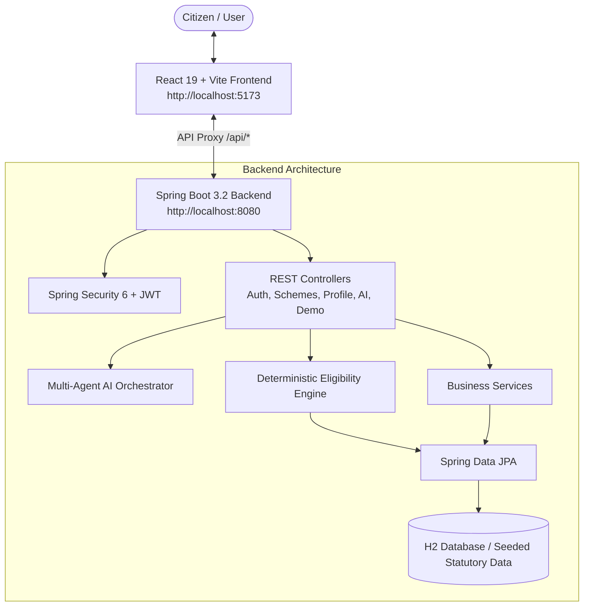

# SchemeSathi (योजना साथी)

> **AI-Assisted Citizen Welfare Discovery & Deterministic Eligibility Platform**  
> Bridging the gap between 1.4 billion citizens and Indian public welfare policies through verifiable, hallucination-free entitlement matching.

---

## 🏛️ Project Overview

**SchemeSathi** is a modern GovTech platform designed to help Indian citizens discover and claim statutory government welfare benefits across Central and State ministries. 

### Core Architectural Philosophy:
> **"LLM UNDERSTANDS. DETERMINISTIC ENGINE DECIDES."**  
> AI and natural language processing are used solely for conversation, profile entity extraction, and multilingual translation. All eligibility assessments are computed strictly by a deterministic rule engine executing codified statutory logic.

---

## 🏗️ System Architecture



---

## 🚀 Key Features

1. **Deterministic Eligibility Rule Engine**:
   - Evaluates citizen criteria (Age, Gender, State, Occupation, Income, Social Category, Landholding, BPL/Ration Card) against statutory rules.
   - Outputs match scores (0–100%), verified pass/fail criterion breakdowns, missing profile details, and clear policy explanations.

2. **Official Government Schemes Database**:
   - Pre-seeded with 10 flagship welfare schemes across Central and State ministries:
     - **PM-KISAN** (Pradhan Mantri Kisan Samman Nidhi)
     - **Ayushman Bharat PM-JAY** (National Health Protection)
     - **Post-Matric Scholarship for SC Students**
     - **Pradhan Mantri Awas Yojana - Gramin (PMAY-G)**
     - **Sukanya Samriddhi Yojana**
     - **Pradhan Mantri Ujjwala Yojana (PMUY)**
     - **MGNREGA** (Rural Employment Guarantee)
     - **Telangana Kalyana Lakshmi / Shaadi Mubarak**
     - **Atal Pension Yojana (APY)**
     - **Pradhan Mantri MUDRA Yojana (PMMY)**

3. **Multi-Agent AI Sahayak (Chatbot)**:
   - Natural language interface that understands citizen queries.
   - Automatically extracts profile details (e.g., occupation, employment status) into structured profile attributes.
   - Cites official sources and suggests 1-click follow-up actions.

4. **Synthetic Sandbox Demo Mode**:
   - Test the system without creating an account or providing real data.
   - 3 pre-configured synthetic personas:
     - **Lakshmi Devi** (35, Female, Small Farmer, Telangana)
     - **Ravi Kumar** (20, Male, SC Student, Rajasthan)
     - **Meena Sharma** (28, Female, General, Urban Professional, Maharashtra)
   - One-click profile switching demonstrating real-time rule adaptation.

5. **Citizen Profile & Completeness Tracker**:
   - Dynamic completeness progress meter (0–100%).
   - Preserves demographic and socioeconomic attributes.
   - Saved schemes bookmarking to track deadlines and application status.

6. **Document Preparation Checklist & Official Portals**:
   - Detailed statutory documents required per scheme (Aadhaar, Land records, Income certificates, Caste certificates).
   - Valid alternatives where permitted.
   - Direct links to official government application portals (`.gov.in` / `.nic.in`) to prevent middleman exploitation.

---

## 🛠️ Technology Stack

### Backend
- **Framework**: Spring Boot 3.2.5 (Java 17+, tested through Java 26)
- **Security**: Spring Security 6 with stateless JWT (jjwt 0.12.5) & BCrypt password hashing
- **Persistence**: Spring Data JPA / Hibernate 6
- **Database**: H2 in-memory/file database (`data/schemesathi`)
- **Architecture**: Portable Pure Java POJO design (zero external annotation-processor dependencies)

### Frontend
- **Framework**: React 19 + Vite 8
- **Routing**: React Router DOM 7
- **Icons**: Lucide React
- **Design System**: Custom GovTech theme (Saffron, Cyan, Emerald accents, dark glassmorphism, responsive grid)
- **HTTP Client**: Axios with JWT interceptor and automatic 401 handling

---

## 📁 Repository Structure

```text
SchemeSathi/
├── README.md                          # Combined Full-Stack Documentation
├── backend/
│   ├── pom.xml                        # Maven configuration
│   ├── src/main/
│   │   ├── java/com/schemesathi/
│   │   │   ├── SchemeSathiApplication.java
│   │   │   ├── controller/            # REST API Endpoints
│   │   │   │   ├── AuthController.java
│   │   │   │   ├── ProfileController.java
│   │   │   │   ├── SchemeController.java
│   │   │   │   ├── AiController.java
│   │   │   │   ├── DemoController.java
│   │   │   │   └── GlobalExceptionHandler.java
│   │   │   ├── dto/                   # Request/Response Data Objects
│   │   │   ├── entity/                # JPA Database Entities
│   │   │   │   ├── User.java
│   │   │   │   ├── Scheme.java
│   │   │   │   ├── EligibilityRule.java
│   │   │   │   ├── RequiredDocument.java
│   │   │   │   ├── CitizenProfile.java
│   │   │   │   ├── CitizenDocument.java
│   │   │   │   └── SavedScheme.java
│   │   │   ├── repository/            # Spring Data JPA Repositories
│   │   │   ├── security/              # JWT & Security Configuration
│   │   │   └── service/               # Core Logic & Engines
│   │   │       ├── EligibilityEngine.java       # Deterministic rule engine
│   │   │       ├── AiAgentOrchestrator.java     # Multi-agent AI pipeline
│   │   │       ├── SchemeService.java
│   │   │       ├── CitizenProfileService.java
│   │   │       ├── AuthService.java
│   │   │       └── DataSeeder.java              # 10 verified schemes & admin
│   │   └── resources/
│   │       └── application.properties # Server & DB Configuration
│   └── .mvn/ / mvnw.cmd               # Maven build wrapper
└── frontend/
    ├── package.json                   # React dependencies
    ├── vite.config.js                 # Vite bundler & API proxy configuration
    ├── index.html                     # HTML root template with SEO meta
    └── src/
        ├── api.js                     # Axios client & endpoint groups
        ├── AuthContext.jsx            # Authentication state & JWT persistence
        ├── index.css                  # GovTech Design System CSS
        ├── App.jsx                    # Application layout & React routes
        ├── components/
        │   ├── Navbar.jsx             # Responsive navigation header
        │   └── Footer.jsx             # National helplines & legal disclaimer
        └── pages/
            ├── HomePage.jsx           # Landing hero, sectors, live stats
            ├── SchemesPage.jsx        # Catalog with search & multi-filters
            ├── SchemeDetailPage.jsx   # Criteria breakdown & live test widget
            ├── EligibilityCheckerPage.jsx # Multi-scheme assessment wizard
            ├── AiAssistantPage.jsx    # AI Sahayak chat interface
            ├── DemoPage.jsx           # Sandbox with 3 synthetic personas
            ├── ProfilePage.jsx        # Citizen profile & saved schemes
            ├── LoginPage.jsx          # Login with 1-click admin demo fill
            └── RegisterPage.jsx       # Citizen registration form
```

---

## ⚡ Quick Start Guide

### Prerequisites
- **Java**: JDK 17 or higher (compatible up to JDK 26)
- **Node.js**: v18.0 or higher with `npm`
- **Maven**: Bundled Maven wrapper or Maven 3.8+

---

### Step 1: Run the Backend

Open a terminal in `backend/`:

```powershell
cd backend
# Using Maven wrapper (Windows)
.\mvnw.cmd spring-boot:run

# Or using installed Maven:
mvn spring-boot:run
```

The backend server starts on **`http://localhost:8080`**.  
On initial startup, `DataSeeder` automatically populates the H2 database with **10 verified schemes** and the **default admin user**.

---

### Step 2: Run the Frontend

Open a second terminal in `frontend/`:

```powershell
cd frontend
# Install dependencies (if not already installed)
npm install

# Start the Vite development server
npm run dev
```

The frontend server starts on **`http://localhost:5173`** with an automated proxy forwarding all `/api/*` calls to `http://localhost:8080`.

---

### Step 3: Access the Application

Open your browser and navigate to:
```
http://localhost:5173
```

---

## 🔑 Default Credentials & Demo Access

### Administrator Account
- **Email**: `admin@schemesathi.in`
- **Password**: `Admin@SchemeSathi2024`
- *(Quick fill available on the Login screen)*

### Citizen Account
- Register any citizen profile via the **Register** button, or test without an account using the **Demo Mode** tab.

---

## 📡 REST API Reference

| Endpoint | Method | Access | Description |
|---|---|---|---|
| `/api/auth/register` | `POST` | Public | Register a new citizen account |
| `/api/auth/login` | `POST` | Public | Authenticate user & return JWT token |
| `/api/schemes` | `GET` | Public | List schemes (supports `?search=`, `?category=`, `?state=`) |
| `/api/schemes/{id}` | `GET` | Public | Get full statutory details & rules for a scheme |
| `/api/schemes/categories` | `GET` | Public | List all available welfare categories |
| `/api/schemes/{id}/eligibility` | `GET` | Authenticated | Deterministic eligibility check for logged-in profile |
| `/api/schemes/eligibility/all` | `GET` | Authenticated | Comprehensive assessment across all active schemes |
| `/api/schemes/{id}/save` | `POST` | Authenticated | Bookmark scheme to user's saved list |
| `/api/schemes/{id}/save` | `DELETE` | Authenticated | Remove scheme from saved list |
| `/api/schemes/saved` | `GET` | Authenticated | Retrieve all bookmarked schemes |
| `/api/profile` | `GET` | Authenticated | Retrieve current citizen's criteria profile |
| `/api/profile` | `PUT` | Authenticated | Save full profile criteria |
| `/api/profile` | `PATCH` | Authenticated | Partial update of profile attributes |
| `/api/ai/chat` | `POST` | Authenticated | Multi-agent AI assistant query |
| `/api/demo/schemes` | `GET` | Public | Schemes for unauthenticated demo sandbox |
| `/api/demo/profiles` | `GET` | Public | Retrieve 3 synthetic citizen personas |
| `/api/demo/eligibility/{id}` | `POST` | Public | Test dynamic criteria against a scheme without account |

---

## 🛡️ Public Welfare Disclaimer

SchemeSathi is an independent informational civic technology application. The platform's eligibility evaluations are automated advisory tools based on publicly available policy notifications. Final approval and disbursement of welfare benefits are governed solely by the respective Government of India ministries, State departments, and authorized welfare officers.
